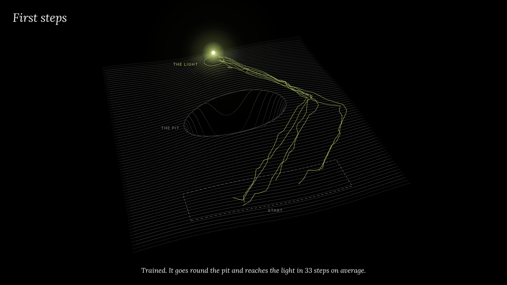

# First steps

[](loop/first-steps-loop.mp4)

<sub>9-second loop. Click for the MP4 (1280×720, 0.49 MB); the GIF above is 1280×720, 1.3 MB.</sub>

How an AI learns to act. A small agent on a square world must reach a light, and a pit lies between where it starts and the light. It is trained from scratch with REINFORCE in NumPy, and the page runs the saved policy **live in JavaScript** at 20 points in training. A slider swaps checkpoints, so you can watch random stumbling turn into a short, confident route around the pit. Nothing on the page is a recording.

## Open it

Open `first-steps.html` in a recent browser. It is a single 0.5 MB file with every checkpoint inlined; it loads three.js 0.147.0 from jsDelivr and two fonts from Google Fonts.

- Six creatures run the selected checkpoint's policy at once, with fresh noise on every step. When they have all finished, a new round starts, and the last round stays as faint trails. A trail turns accent-coloured when its try reaches the light. When a try falls in, the pit's rim flashes and a small cross marks where it went in.
- **Slider**: 20 checkpoints, from episode 0 to 10,240. Above it, the learning curve shares the x axis: the bright line is the share of 1,000 test runs that reached the light at each checkpoint, and the grey line is the same share within the training batches (a rolling mean over 8 updates of 32 episodes).
- **Watch it learn** steps through 11 checkpoints, one round each (about 45 s). It starts on its own shortly after the page loads, unless the visitor prefers reduced motion.
- **Wants**: an arrow field of the policy's mean move μ(s) at each spot.
- **Value**: the ground brightens where the critic V(s) expects a high return. All checkpoints share one scale.
- **How it works**: the world's rules, the method, a table of every checkpoint and the limits.
- Keys: <kbd>←</kbd> <kbd>→</kbd> checkpoint, <kbd>Space</kbd> pause, <kbd>L</kbd> learn, <kbd>W</kbd> wants, <kbd>V</kbd> value, <kbd>H</kbd> panel, <kbd>Esc</kbd> close. With reduced motion the camera stays still, nothing plays on its own, and each checkpoint shows one finished round of six tries.

## Method

**World** (`train.py`; the page's `stepEnv` copies it rule for rule):
- The world is the square [-0.97, 0.97]². Each try starts at a random point in the band x ∈ [-0.6, 0.6], y ∈ [-0.88, -0.62].
- The light is at (0, 0.72); getting within 0.09 of it counts as reaching it.
- The pit is an ellipse centred at (0, 0.04) with semi-axes 0.44 and 0.22. Every straight line from the start band to the light crosses it.
- An action is (dx, dy), clipped to [-1, 1] and scaled by 0.06. The walls clamp.
- Reward per step: 2 × (distance gained toward the light) − 0.005. Reaching the light adds +2 and ends the try; falling in the pit adds −1 and ends it. A try times out after 100 steps. γ = 0.99.
- The landscape heights on the page are decoration. The agent never sees them.

**Policy:** an MLP 2 → 48 → 48 → 2 with tanh throughout, giving the mean move μ(s) ∈ (-1, 1)², plus Gaussian noise with a learned, state-independent σ per axis: 2,596 parameters.
**Critic (baseline):** an MLP 2 → 48 → 48 → 1 (tanh hidden layers, linear output), 2,545 parameters, fitted to Monte Carlo returns by MSE.

**Update:** REINFORCE with a learned baseline.
1. Roll out 32 episodes and compute the discounted return-to-go G_t.
2. Advantage A = G − V(s), normalised within the batch.
3. One Adam step (lr 5e-3) on −mean[A · log N(a; μ(s), σ²)], with ∂/∂μ = (a − μ)/σ² and ∂/∂log σ = (a − μ)²/σ² − 1.
4. Four Adam steps (lr 3e-3) on the critic.

log σ is clamped to [-2.3, 0.3]. Training runs 320 updates, 10,240 episodes, seed 7.

**Hand-derived gradients:** the MLP backward pass, the Gaussian log-likelihood gradients and Adam are written out by hand (no autograd). `gradcheck()` compares them with central finite differences before every training run; the worst relative error is 2.4e-7.

### What is standard, and what was built for this piece

- **Standard:** REINFORCE (Williams, 1992) with a state-value baseline, Gaussian policies, advantage normalisation, Adam, and potential-style progress shaping.
- **Built for this piece:** the light-and-pit world and its constants; the NumPy implementation and its hand-derived backprop; the checkpoint schedule and export format (policy as float32, critic as float16, both base64, plus 64 test states so the page's maths can be checked against NumPy); and the page itself.
- The environment constants came from a small sweep. A first version with a slower agent (0.045 per step), a 90-step limit and a −2 pit penalty learned only to stop at the pit's edge, and never reached the light in 6,000 episodes.

## Numbers

Each checkpoint is evaluated on 1,000 stochastic test runs with seed 1234, sampling noise exactly as the page does.

| episode | reach the light | fall in the pit | time out | mean steps (when it makes it) | σ (mean) |
|---:|---:|---:|---:|---:|---:|
| 0 | 0.0% | 28.9% | 71.1% | – | 1.00 |
| 64 | 0.3% | **73.8%** | 25.9% | 91 | 1.00 |
| 256 | 37.4% | 39.3% | 23.3% | 79 | 1.00 |
| 1,024 | 65.4% | 16.0% | 18.6% | 68 | 0.98 |
| 2,048 | 59.1% | 20.1% | 20.8% | 58 | 0.94 |
| 4,096 | 75.0% | 22.7% | 2.3% | 63 | 0.87 |
| 5,120 | 95.5% | 2.2% | 2.3% | 53 | 0.80 |
| 6,144 | 99.6% | 0.4% | 0.0% | 45 | 0.69 |
| 10,240 | **98.4%** | 1.6% | 0.0% | **33** | 0.43 |

- First it learns that closer is better and walks straight into the pit (pit falls rise from 28.9% to 73.8% by episode 64). Then it finds a way round. Late gains come from speed (91 → 33 steps) and less noise (σ 1.00 → 0.43).
- Every successful test run, at every checkpoint, goes round the **right-hand** side of the pit.
- Training takes seconds, not hours: the final run logged 7.3 s of wall-clock time, and identical earlier runs took 16 s and 19 s, depending on the machine and its load. Re-running `train.py` reproduces the checkpoints bit for bit.
- The page's JavaScript forward pass matches NumPy to 5.1e-7 (max |Δμ| over 64 states × 20 checkpoints). The page's own 1,000-run evaluation, with a different random generator, gives 0% / 0.1% / 39.9% / 66.4% / 96.1% / 98.8% reaching the light at episodes 0 / 64 / 256 / 1,024 / 5,120 / 10,240, against Python's 0% / 0.3% / 37.4% / 65.4% / 95.5% / 98.4%.

## Limits

- **One fixed map.** The policy sees only its (x, y), so it has memorised a vector field for this map. It has not learned what a pit is; move the light and it would fail.
- **One route.** It never learned to pass on the left; from the left side of the start band it still walks right. That is a local optimum REINFORCE settled into, not a property of the task.
- **Still noisy at the end.** The page runs the stochastic policy, so 1.6% of trained tries still fall in. The mean action alone reached the light in 1,000 of 1,000 runs (26.2 steps on average), but that was checked once by hand, is not logged, and is not what the page shows.
- **Learning is not monotone.** Test success drops at 768 and 2,048 episodes, and the training-batch curve dips sharply around episode 7,000 (81% against 99.6% shortly before). REINFORCE is high-variance, and the slider shows the dips rather than hiding them.
- **Small evidence.** The constants were tuned on seed 7, with a quick check of seeds 1–3 (92–99% success at about 10k episodes). That is not a robustness study. With 1,000 test runs per checkpoint, each percentage carries up to about ±1.5 points of sampling error (less near 0% or 100%). The six-creature tally on the page is a handful of tries, not a measurement.
- Checked only in headless Chromium with software WebGL (about 10 fps on a shared 2-core machine); real GPUs will be smoother. Not tested in Safari or Firefox.

## Run the training

Needs Python 3 and NumPy.

```bash
python3 train.py --check   # gradient check only
python3 train.py           # gradient check, then training -> ckpt/ep_XXXXX.npz, log.json
```

The export script that packs the checkpoints into the page, its page template and the Playwright check are not included in this repository, so `first-steps.html` is the built page as shipped.

## In this repository

- `first-steps.html`: the piece
- `train.py`: the world, the networks, the gradient check and training
- `screenshots/`: the episode-64 fall into the pit, the trained route, and the phone layout
- `loop/`: the loop video, its GIF and a poster

## Credits and license

REINFORCE: Ronald J. Williams, *Simple Statistical Gradient-Following Algorithms for Connectionist Reinforcement Learning*, Machine Learning 8, 1992. three.js is MIT; the fonts are under the SIL Open Font License.

Code: MIT. See [LICENSE](LICENSE).

Built with Claude for Joe Gao.
